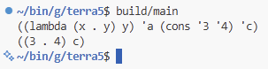

a small non-final version of lisp
-------------------------------------

this is a lisp!
not much else to say about that. it doesn't have garbage collection, and instead
it uses arena allocation. the evaluator for lisp expressions is structured
very similarly to the original LISP's `eval`.
sadly i did use ai to make the parser, because i don't think
i had enough time to learn how to use yacc.

> it would take another week or so to replace the figurative stilts this project stands on with real supports.

a list of things i could change later:
- human-written parser
- purely c parser
- make inputting normal
- garbage collection
- add environment that changes throughout
- add support for numbers in lisp atoms



How to run:
- it's an elf file, so:
	- download the release
	- `chmod +x` the executable
	- `./` the executable
- type an expression in. examples include:
```lisp
(quote a)
'a
(quote (a b))
(quote (a . b))
(quote (a . (b . c)))
(quote (a b . ()))
(atom 'a) ; prints the ascii 0x01. also comments aren't implemented 
(atom '(a b))
(atom '())
(eq 'a 'a)
(eq 'a 'b)
(eq '(a b) '(a b))
(car '(a b c))
(car '(a . b))
(cdr '(a b c))
(cdr '(a . b))
(cons 'a 'b)
(cons 'a '(b c))
(cond ('() . 'no) ('t . 'yes) ('t . 'never))
((lambda (x) (cons x 't)) 'a)
((lambda (x . y) y) 'a (cons '3 '4) 'c)
((label f (lambda (x) (cond ((atom x) . x) ('t . (cons (cons (car x) 'f) (f (cdr x))))))) '(a b c . e))
((label sub (lambda (x y z) (cond ((atom z) . (cond ((eq z y) . x) ('t . z))) ('t . (cons (sub x y (car z)) (sub x y (cdr z)))))))
	'b 'a '(c a (b . a) a e)) ; he put it reverse for some reason
```
- press ^D (ctrl-D) to end input (it doesn't check automatically)
- then it will evaluate it, print your output, and quit.
